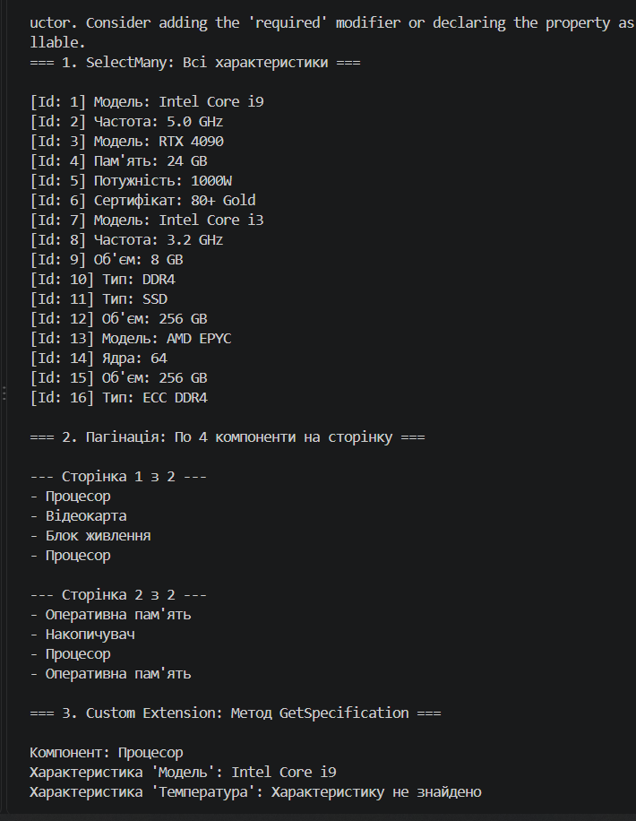

# Лабораторна робота №11. LINQ: SelectMany, пагінація й custom extensions

**Варіант:** 15 (Комп'ютери, компоненти, характеристики)

## Опис реалізації

У цій лабораторній роботі реалізовано використання розширених можливостей LINQ для роботи зі складеними колекціями об'єктів. Згідно з варіантом 15, створено предметну область із сутностями `Computer`, `Component` та `Specification`.

Виконано такі завдання:
1. **SelectMany:** Використано для розгортання вкладених колекцій та отримання єдиного плоского списку всіх характеристик (`Specification`) з усіх компонентів системи.
2. **Пагінація (Skip / Take):** Реалізовано посторінкове виведення списку компонентів. Елементи розбиті на сторінки по 4 компоненти на кожну.
3. **Метод розширення (Custom Extension):** Створено власний метод розширення `GetSpecification(string key)` для класу `Component`, який дозволяє безпечно та зручно шукати конкретну характеристику за її назвою (ключем).
4. У методі `Main` продемонстровано роботу всіх запитів та виведено результати в консоль.

## Результат роботи програми

Нижче наведено скріншот успішного виконання програми та виведення результатів запитів LINQ:

![Результат роботи програми] 